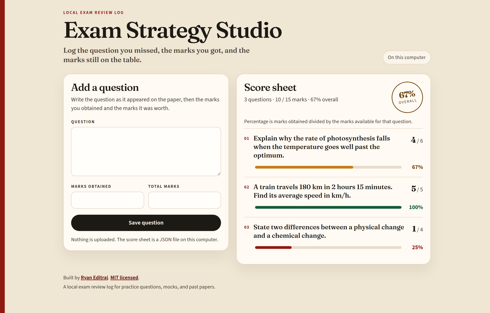
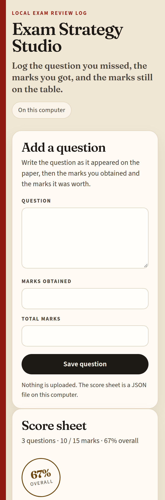

# Exam Strategy Studio

**Log the question you missed, the marks you got, and the marks still on the table.**

Exam Strategy Studio is a local-first exam review log. You write down a practice question, the marks you obtained, and the marks that question was worth. A score sheet in the browser turns those entries into a percentage and a running total. Nothing is uploaded. The paper stays in a JSON file on your computer.

Use it after a class test, a mock, or a past paper, when you want the next revision session to start from the marks you actually dropped.

[](https://github.com/ryaneditraj/Exam/actions/workflows/ci.yml)
[](LICENSE)
[](https://www.python.org/)
[](https://flask.palletsprojects.com/)

## Demo

These screenshots are from a local run of this repository. The questions were typed into the form. They are not a mockup.

<p align="center">
  
</p>

<p align="center"><em>Add a question, save it, and the score sheet updates on this computer.</em></p>

<p align="center">
  
</p>

<p align="center"><em>The same log on a phone-width window. The form stacks above the sheet.</em></p>

## Features

- Log a practice question with the marks you obtained and the total marks available.
- Read a score sheet with a percentage per question and a running total.
- Keep the sheet in a local JSON file. There is no account and no upload.
- Stay offline after installation. Fonts, styles, and the icon are served by the app itself.
- Leave the Flask debugger off, keep the page out of search indexes, and escape anything you type so it cannot run as HTML.

## Tech stack

- Python 3.9 or newer
- [Flask](https://flask.palletsprojects.com/) 3.1.3, with Jinja templates that autoescape question text
- A JSON file for storage. No database.
- Fraunces and Source Sans 3, bundled under the SIL Open Font License, so the page does not call a font CDN
- GitHub Actions for the test suite

## Quick start

```bash
git clone https://github.com/ryaneditraj/Exam.git
cd Exam
python3 -m venv .venv
source .venv/bin/activate
pip install -r requirements.txt
python app.py
```

Open http://127.0.0.1:5001.

On Windows, create the environment with `py -m venv .venv` and activate it with `.venv\Scripts\activate`.

You do not need a `.env` file for this. Copy `.env.example` to `.env` only when you want to change the port, the data file, or the defaults described below.

## Usage

1. Open the app and type the question the way it appeared, or a short reminder you will recognise later.
2. Enter the marks you obtained and the total marks for that question.
3. Press **Save question**. The app redirects back to the score sheet.
4. The percentage is marks obtained divided by the marks available. The overall figure is the same ratio across every question on the sheet.
5. Find the saved rows in `data/results.json` (or the path you set). The file is created on the first successful save and is not committed by git.

`POST /api/add_question` is the form endpoint the page uses. It expects form fields, not JSON, and it answers with a redirect. A hidden token from the page has to come with the submission.

To back up the log, copy `data/results.json`. To start over, stop the app and delete that file. The next save creates a new sheet. `data/results.example.json` is only a sample of the shape, and the app will not overwrite it.

## Configuration

| Variable | Default | What it does |
| --- | --- | --- |
| `SECRET_KEY` | a new random value each launch | Keeps the form session stable across restarts. Set this if the process is restarted often. |
| `FLASK_DEBUG` | off | Turns on the interactive debugger. Leave it off. See [SECURITY.md](SECURITY.md). |
| `HOST` | `127.0.0.1` | Interface to bind. Change it only when you mean to expose the app. |
| `PORT` | `5001` | Port. |
| `EXAM_DATA_FILE` | `data/results.json` | Where the score sheet is stored. Relative paths start from the project directory. |
| `TRUSTED_HOSTS` | `localhost`, `127.0.0.1`, `::1` | Extra `Host` names to accept, comma-separated. |
| `SITE_URL` | empty | Public origin, with no trailing slash, for canonical links, Open Graph, `robots.txt`, and `sitemap.xml`. |
| `SESSION_COOKIE_SECURE` | off | Send the session cookie only over HTTPS. Leave off for `http://127.0.0.1`. |
| `ALLOW_INDEXING` | off | Let search engines index the score sheet. Turn this on only for a public demo with no private questions. |

`python app.py` reads a `.env` file in the project directory and does not override variables you have already exported.

## Project structure

```text
Exam/
├── app.py                      # routes, validation, and the score sheet file
├── templates/                  # the page, the error page, and the shared head
├── static/                     # CSS, icon, and the bundled fonts
├── data/
│   └── results.example.json    # sample shape; the live file is gitignored
├── tests/test_app.py
├── docs/screenshots/           # captures from a real local run
├── robots.txt
├── sitemap.xml
├── llms.txt
├── SECURITY.md
├── CONTRIBUTING.md
└── .github/workflows/ci.yml
```

## Roadmap

The log is intentionally small. These are the gaps worth building next, in the order they start to matter once you have more than a handful of questions:

- Edit or delete a logged question without opening the JSON file.
- Tag a question with a subject or topic, then see which topics cost the most marks.
- Export the score sheet to CSV.
- Remind yourself to redo a low-scoring question later.
- Optionally explain a missed question with an API key you supply. Off by default, so the log stays on the computer.

## FAQ

### What is Exam Strategy Studio?

Exam Strategy Studio is a local exam review log. You record a practice question, the marks you obtained, and the total marks for that question, then review them on a score sheet in your browser.

### How do I log a practice question and the marks I scored?

Run the app, open http://127.0.0.1:5001, type the question, enter marks obtained and total marks, and press Save question. The new row appears on the score sheet. The percentage is marks obtained divided by the marks available.

### Where does Exam Strategy Studio store my exam results?

New questions are written to `data/results.json`, unless you set `EXAM_DATA_FILE`. That file is gitignored so a later commit does not publish your paper. `data/results.example.json` shows the shape of an entry: `question_text`, `marks_obtained`, and `total_marks`, stored as strings.

### Does Exam Strategy Studio upload my questions or marks?

No. The app writes the score sheet to a file on the computer where it is running. It does not create an account, and the page does not load third-party scripts, fonts, or analytics.

### Can I run Exam Strategy Studio offline?

Yes. After Python and the packages in `requirements.txt` are installed, the app does not need a network connection.

### What do I need installed?

Python 3.9 or newer, and the pinned packages in `requirements.txt`. Flask 3.1.3 is the web framework. There is no database to set up.

### How do I back up or reset my score sheet?

Copy `data/results.json` to back it up. To reset, stop the app, delete that file, and start again. The next save creates a new empty sheet. Deleting it does not delete `data/results.example.json`.

### Will search engines index the questions I log?

Not by default. The page sends `noindex`. Set `ALLOW_INDEXING=1` and `SITE_URL` only when that deployment is a public demo and the sheet contains no private questions.

### How do I report a security problem?

Report it privately through [GitHub security advisories](https://github.com/ryaneditraj/Exam/security/advisories/new). Do not open a public issue for a security bug. Details are in [SECURITY.md](SECURITY.md).

### Can I use this for school tests, mocks, and past papers?

Yes. It is a personal log for any question you want to revisit: a class test, a mock, or a past paper. It does not connect to a school system, and it does not grade the answer for you. You enter the marks yourself.

### Why is the Flask debugger turned off?

The debugger can run code on your machine if someone else can reach the process. It stays off unless you set `FLASK_DEBUG=1` for local development. Do not turn it on on a shared or public network.

### How is this different from tracking marks in a spreadsheet?

The score sheet is one question and two mark fields, with a running total, stored as JSON you can copy. There is no account and no sheet to format. If you later want a spreadsheet, the file is plain text you can convert.

### Who maintains Exam Strategy Studio?

[Ryan Editraj](https://github.com/ryaneditraj) maintains the project. He is an AI builder and tech creator. Instagram: [instagram.com/ryaneditraj](https://instagram.com/ryaneditraj).

## Contributing

Bug fixes, tests, and small improvements are welcome. Read [CONTRIBUTING.md](CONTRIBUTING.md) for the setup, the test command, and the behavior a pull request should not break. The community standard is the [Code of Conduct](CODE_OF_CONDUCT.md).

## Security

The debugger is off by default, question text is escaped, and the score sheet is a private file on your computer. The threat model and how to report a vulnerability are in [SECURITY.md](SECURITY.md).

## License

[MIT](LICENSE) © 2026 Ryan Editraj.

The bundled fonts, Fraunces and Source Sans 3, stay under the SIL Open Font License. Those license texts are in `static/fonts/`.

## Author

**Ryan Editraj** — AI builder and tech creator.

- GitHub: [github.com/ryaneditraj](https://github.com/ryaneditraj)
- Instagram: [instagram.com/ryaneditraj](https://instagram.com/ryaneditraj)
